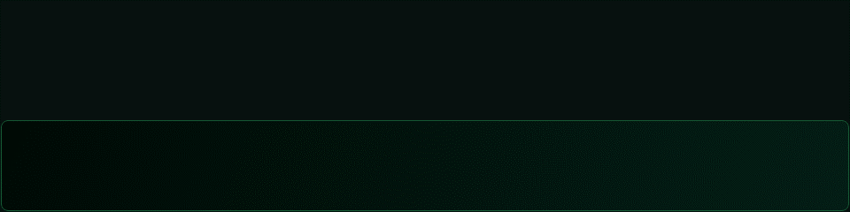
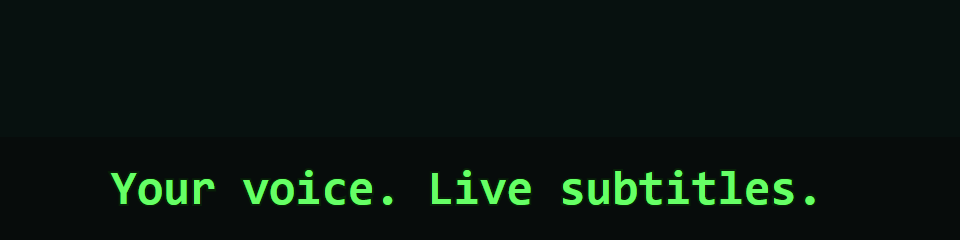
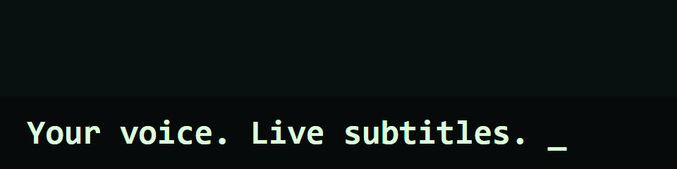
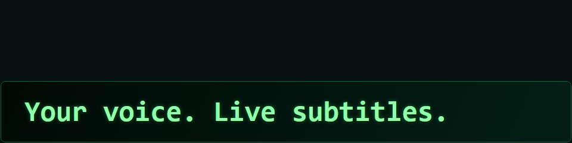
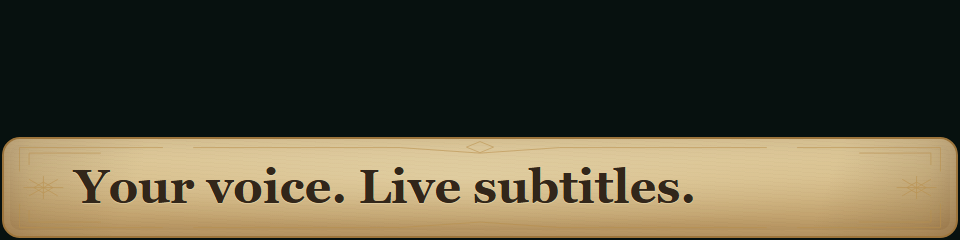
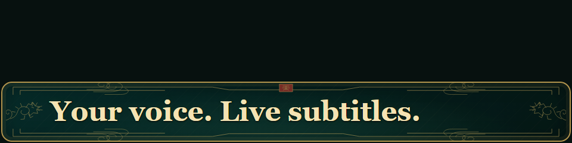

<div align="center">

# OBS Live Translate — Offline Russian Speech-to-Text & Live Captions

### Your voice. Live subtitles. Everything stays on your PC.

A free, open-source OBS Studio plugin for Windows that turns Russian speech into live captions using local Whisper speech recognition (STT). Add Russian subtitles or translate Russian speech into English, with animated browser overlays, seven visual styles, and CPU or Vulkan GPU inference. No cloud API or API key; works offline after installation and model download.

Бесплатный плагин OBS для распознавания русской речи и автоматических субтитров в реальном времени. Работает локально через Whisper, переводит речь с русского на английский и выводит анимированные субтитры на стрим.

[](#requirements)
[](#what-it-does)
[](#styles)
[](LICENSE)

[**Download the stable build**](https://github.com/esnqduke/OBS-Live-Translate/releases/latest) · [**Windows setup**](docs/INSTALL-WINDOWS.md) · [**Build from source**](docs/BUILDING.md) · [**Русская инструкция**](README-INSTALL-WINDOWS-RU.md)



*Matrix code rain, captured from the actual bundled subtitle renderer with sample text.*

</div>

## What it does

**OBS Live Translate** is a native OBS audio filter. It receives audio from the source you attach it to, runs Whisper locally, and sends captions to an OBS Browser Source or Text (GDI+) source.

| Capability | How it works |
|---|---|
| Russian captions | Transcribe Russian speech in Russian |
| English translation | Translate Russian speech into English locally |
| Local inference | Whisper runs inside the DLL; no cloud API, key or separate model server |
| CPU or Vulkan GPU | Choose the compute mode in the audio filter |
| Reading comes first | Up to three rows; new lines enter below, previous lines move upward |
| Time to finish reading | Configurable reading time, per-character timing, row interval and 1–3 visible rows |
| OBS microphone mute | Cancel recognition, discard buffered speech and clear captions; resume only new speech |
| Seven visual styles | Plain, Matrix, Console, Cyberpunk, Matrix Rain, Fantasy and Grand Cathay-inspired |
| Independent backgrounds | Transparent, solid, gradient, parchment, Cathay ornament or a local image |
| Adjustable appearance | Colors, background opacity, padding, corners, borders and image fit |
| Offline operation | No internet connection needed after installation and model download |

Tune subtitle timing and presentation directly in the audio filter: minimum reading time, extra time per character, spacing between rows and one to three visible rows. Adjust animation speed from 10% to 500%, turn animations off, choose automatic or manual text size, set alignment and show or hide partial results. Display changes keep the model loaded and preserve unread captions. Clear captions and buffered audio with one button, or restore the display defaults while keeping your model, style and background.

Muting the microphone source in the OBS mixer, including through a hotkey, pauses STT, cancels recognition in progress and clears displayed and queued captions. Unmuting resumes with fresh speech while the model stays loaded. This follows the mute state of the source carrying the filter; hardware mute and a volume slider at zero do not set OBS mute.

See [display controls and mute behavior (RU)](docs/CAPTION-CONTROLS-RU.md) and [release notes](docs/releases/caption-controls-and-obs-mute-2026-11-04.md).

Captions wait their turn instead of replacing unread text. During sustained fast speech, the queue can deliberately lag behind the speaker. Hidden or stalled browser frames do not consume reading time.

## Matrix in motion

The code-rain style uses falling glyphs and short trails that settle into actual subtitle characters. The original Matrix style keeps its changing-symbol reveal:


Both GIFs use a synthetic transcript feed and a neutral dark backdrop. They show the real HTML/CSS/Canvas assets shipped in the plugin, not a separate animation mockup or a recording of live microphone recognition.

## Styles

| Matrix | Console | Cyberpunk |
|:---:|:---:|:---:|
|  |  |  |
| Changing symbols and green text | Typewriter reveal and cursor | Short glitch and neon outline |

| Matrix Rain | Fantasy | Grand Cathay-inspired |
|:---:|:---:|:---:|
|  |  |  |
| Falling code settles into words | Gilded reveal and parchment | Ink reveal, jade and gold |

Plain is also available. Ornament artwork is original CSS/inline SVG. The Cathay-inspired theme is an unofficial fan-inspired style, not an official game asset or endorsement.

Choose text style and background separately in the **audio filter's settings**. Enable manual background settings for colors, opacity, padding, borders and corners. PNG, JPEG and WebP backgrounds up to 16 MiB are supported. Visual changes preserve the queue without reloading the model.

## Quick start

1. Install [OBS Studio](https://obsproject.com/download) and the [Microsoft Visual C++ v14 Redistributable x64](https://learn.microsoft.com/en-us/cpp/windows/latest-supported-vc-redist/).
2. Download the [stable Windows package](https://github.com/esnqduke/OBS-Live-Translate/releases/latest), close OBS, and copy its `obs-live-translate` folder into:

   ```text
   C:\ProgramData\obs-studio\plugins\
   ```

3. Download a supported model, for example [medium-q5_0](https://huggingface.co/ggerganov/whisper.cpp/resolve/c521a4b02f422512d734391fdf08bb08c0862f68/ggml-medium-q5_0.bin), and save it locally. Models are not bundled.
4. Add a **Browser Source**. For a 1920×1080 scene, start with **1920×384**. Leave **Local file disabled**.
5. Open your microphone's **Filters**, add **Live Translate — local Whisper (RU / EN)**, select the model and Browser Source, then click **Connect selected browser**.
6. Enable **Translate Russian speech to English** for English output, or leave it disabled for Russian captions. Choose CPU/GPU and wait for loading and warmup.
7. Choose a style and background, then speak Russian. Place the Browser Source above your video in the scene's source order.

The plugin sets its local URL itself. No server command, manually selected HTML file or custom CSS is needed. After updating overlay assets, use **Refresh cache of current page** in Browser Source properties.

See the [complete Windows guide](docs/INSTALL-WINDOWS.md) for model checksums, portable OBS, troubleshooting and rollback.

## Requirements

- **Windows 10/11 x64**, OBS Studio x64 with `obs-browser`; tested with **OBS 32.2.2**.
- An x64 CPU with **AVX2, FMA and F16C**.
- A current **Microsoft Visual C++ v14 x64 runtime**, compatible with the MSVC 2026 build tools.
- A supported model and enough system/video memory for that model and your workload.
- The stable Vulkan package requires system **Vulkan Runtime (`vulkan-1.dll`) even with GPU inference disabled**. A compatible graphics driver normally supplies it. A machine without it needs a separate CPU-only build.

GPU acceleration was tested on **NVIDIA RTX 4070 SUPER, 12 GB VRAM**. Other GPUs need validation. Only the selected **Vulkan0** device is accepted because of an upstream Whisper limitation; this index need not match Windows Task Manager's GPU number. Multi-GPU systems may need CPU mode.

Python, Node.js, Visual Studio, CUDA Toolkit and Vulkan SDK are **not runtime requirements**. Windows ARM64 and CPUs without the listed instructions are not supported targets for this build.

## Models

Only these exact multilingual whisper.cpp `.bin` files are accepted. Size and SHA256 are checked before loading:

| Model | File size | Suggested use |
|---|---:|---|
| `ggml-base.bin` | 147,951,465 bytes | First run or lower CPU load |
| `ggml-medium-q5_0.bin` | 539,212,467 bytes | Main tested GPU setup |
| `ggml-large-v3.bin` | 3,095,033,483 bytes | Optional comparison on more capable hardware |

Input is currently **Russian**; output is Russian transcription or English translation. Arbitrary models, `.en`, GGUF, ONNX and Turbo variants are not supported. [Download and verify models](docs/INSTALL-WINDOWS.md#models).

## How it fits together

```text
Audio source in OBS
    └─ Live Translate audio filter
         ├─ Whisper inference: CPU / Vulkan
         ├─ Revisioned caption queue
         ├─ Local loopback bridge → Browser Source → Scene
         └─ Text (GDI+) output is also available
```

The browser acknowledges captions after all their rows receive reading time. Unread final phrases remain in the native journal until acknowledged. Reloading can replay an unfinished phrase. Queues are bounded and overflow is explicit. Restarting the filter starts a new session.

## Development and validation

C++17, pinned [whisper.cpp v1.7.6](https://github.com/ggml-org/whisper.cpp/tree/v1.7.6), WinSock, and dependency-free HTML/CSS/Canvas. See [building and tests](docs/BUILDING.md).

Validation includes eight native test suites and 28 JavaScript tests, worker mute/cancellation checks, and an immediate UI-dispatch regression test. Browser rendering was checked with Chrome animation/lifecycle captures and native bridge acknowledgment checks. OBS 32.2.2 startup with the configured scene and medium model on Vulkan was also verified on the tested workstation. This does not guarantee identical performance on every PC or compatibility with every OBS release.

## License and acknowledgments

[GPL-2.0-or-later](LICENSE). Whisper/ggml and Vulkan header notices are in [data/licenses](data/licenses). This independent project is not affiliated with OBS Project or the game/franchise referenced by its optional Cathay-inspired visual theme.
